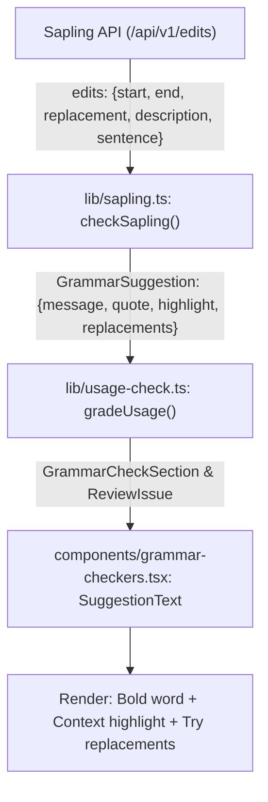

# Plan: Apply Structured Highlighting and Suggestions to Sapling

## Overview

Bring Sapling's grammar check responses to feature parity with LanguageTool by populating the structured `GrammarSuggestion` fields (`quote`, `highlight`, and `replacements`) in `lib/sapling.ts`. This allows `components/grammar-checkers.tsx` to render the flagged word in bold, show the context line with `<mark>` highlighting, and display the "Try" suggestions list.

---

## Files Affected

1. `lib/sapling.ts` (Primary implementation)
2. `test/sapling.test.ts` (New unit test suite with mock fixtures)
3. `test/check-usage.test.ts` (Update existing integration tests if needed)

---

## Detailed Implementation Steps

### 1. Update `lib/sapling.ts`

- Import `isRangeWithin`, `type GrammarHighlight`, `type GrammarQuote`, `type GrammarSuggestion` from `lib/issues`.
- Expand `SaplingEdit` type to include optional fields returned by Sapling API: `sentence`, `sentence_start`, `error_type`, `general_error_type`.
- Build helper functions:
  - Span and offset calculation for sentence-relative highlighting (`edit.start - (edit.sentence_start ?? 0)`).
  - Clean replacement extraction: non-empty replacement strings mapped to `replacements: [replacement]`.
  - Structured `quote` construction:
    - `base`: `edit.description?.trim() || "Suggested edit:"`
    - `word`: original text slice (`text.slice(start, end).trim()`)
    - `context`: `edit.sentence?.trim() || text.trim()`
    - `highlight`: offset and length within `context`
- Populate `GrammarSuggestion` object for each valid edit:
  - `message`: readable summary (e.g. `"${description} ${original} → ${replacement}"`)
  - `quote`: structured quote object
  - `highlight`: character range of the target word inside `message`
  - `replacements`: array of replacements (e.g. `[replacement]`) when non-empty

### 2. Create `test/sapling.test.ts`

- Add unit tests for `checkSapling` mirroring `test/languagetool.test.ts`:
  - Standard replacement (e.g. `"He go to school"` -> `go → goes`)
  - Article replacement (e.g. `"She ate a apple"` -> `a → an`)
  - Deletion edit (e.g. `"I have a books"` -> `a → ""`)
  - Punctuation insertion (e.g. `"However we left"` -> `However → However,`)
  - Whole-sentence spelling correction (e.g. `"using worker threds"`)
  - API errors and 401/500 responses
  - Malformed or empty edit payloads

### 3. Verify Integration

- Run `npm test` to verify `test/sapling.test.ts`, `test/languagetool.test.ts`, and `test/check-usage.test.ts`.
- Run `npm run typecheck` and `npm run lint` to ensure zero type and lint regressions.

---

## Edge Cases Handled

- **Empty replacements (deletions)**: If `replacement` is `""`, `replacements` array is omitted/empty so UI doesn't render an empty "Try" block.
- **Insertions (zero-length span)**: Highlight falls back gracefully if `start === end`.
- **Missing description**: Default label supplied so `quote.base` is always readable.
- **Quotes in `.env`**: Preserve `saplingApiKey()` unquoting logic so API keys with leading/trailing quotes continue to resolve cleanly.
